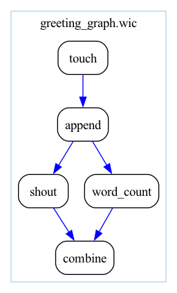

# Connecting steps

You have connected steps since chapter 1: `!&` names what a step made and
`!*` hands it on. In this chapter you will learn the rules those names
follow, and give the workflow's result a name of your own, so that whoever
runs it, or a workflow that uses it as a step, finds the greeting file
without knowing which step made it. Then you will let the greeting branch
into two steps and join again, and see that a workflow is a graph, not a
list.

## The rules for connections

A connection joins one step's output to a later step's input. In `.wic`
each connection has a name, defined with `!&` on an entry of a step's `out:`
list and used with `!*` on an input, as in `greeting.wic`:

```{literalinclude} cookbook/greeting.wic
:language: yaml
:caption: greeting.wic
```

The names follow a few rules, and Sophios reports each broken one by code:

- A name is used after the step that defines it. A `!*` above its `!&` is
  `wic025`, and so is a name nothing defines.
- A name is defined once. A second `!& empty_file` is `wic026`.
- `!&` goes only on an `out:` entry, because a connection starts where its
  value is made. On an input it is `wic019`.
- A name may be used by any number of later steps, and a name nothing uses
  is not an error.
- An output whose type can never fit the input, a `string` into a `File`
  for instance, is `wic023`.

In Python the connection is an assignment, `cat.inputs.file =
append.outputs.file`, and the output object is the name. The step that
makes the output must come earlier in the workflow's list of steps than the
step that reads it, and both must belong to the same `Workflow`; otherwise
Sophios raises `api002` and says which step to move or add. Types are
compared when you assign, so a mismatch stops the script at that line with
`api003`. A string is never a connection: `cat.inputs.file = 'append/file'`
gives `cat` a `File` whose `location` is `append/file`, not the output of
`append`.

[§4 of the `.wic` reference](wic-reference.md#4-edges) has the complete
rules, including how names cross into a workflow used as a step.

## Name the workflow's result

The greeting file is the point of the workflow, but so far it comes out
under a name Sophios made, `append~file`. A **workflow output** gives it a name of
your choosing. Save this pair:

```{literalinclude} cookbook/greeting_output.wic
:language: yaml
:caption: greeting_output.wic
```

```{literalinclude} cookbook/greeting_output.py
:language: python
:caption: greeting_output.py
```

In `.wic`, the `outputs:` section declares `greeting`, a `File`, and
`outputSource: append/file` says it is the output `file` of the step
`append`. In Python, `flow.outputs.greeting = append.outputs.file` declares
the output and connects it in one line. Run either form:

```bash
sophios --yaml greeting_output.wic --run_local
```

```bash
python greeting_output.py
```

The Python run first says what you added:

```text
Adding a new output greeting to workflow greeting_output
 starting compilation of greeting_output
finishing compilation of greeting_output
...
Success! Runner outputs are under /home/you/sophios-tutorial/autogenerated/outdir_cwltool_greeting_output_2026_10_18_22.21.36/
```

After the `.wic` run, `output_greeting_output.json` lists your name beside
the names Sophios made:

```text
append~file
cat~output
greeting
touch~file
```

On the command line a workflow output adds a name; it hides nothing. Every
output of every step is still kept under its made name, so nothing a step
made is lost, and your name stays the same when you add or move steps. A
Python workflow that names outputs keeps only those, so after the Python run
the file lists `greeting` alone.

An output with no `type:` takes the type of the output it names. An output
names exactly one step output: to combine several, give them to one step's
input, as [Types and records](types-and-records.md) shows, and name that
step's output. When the same step id appears twice in a `.wic` file,
`outputSource` names the one you mean by its position, as in
`(2, append)/file`.

### `compile()` returns only the outputs you named

There is one place where the Python API keeps less than a run. For a
workflow that names outputs, `Workflow.compile()` returns only those:

```python
from greeting_output import workflow

print(sorted(workflow().compile().cwl_workflow['outputs']))
```

```text
['greeting']
```

A workflow that names none gets every step output from `compile()`, as the
command line compiles it. `Workflow.run()` and the command line always run
with every output, which is why the run above listed four.

## Branch and join: the greeting becomes a graph

So far each step's result has fed exactly one later step, and the workflow
has been a straight line. Real analyses branch. One result feeds several
steps, which have nothing to do with each other and could run at the same
time, and a later step joins what they made. A workflow is a graph, a
**directed acyclic graph** to be exact: steps, with arrows for the data
flowing between them, that never loop back. You already have everything you
need to write one: a connection's name may be used by any number of later
steps, and one step may read from several.

Here the greeting file feeds two steps, `shout`, which writes a copy in
capital letters, and `word_count`, which counts its words; then `combine`
puts the two results into one report. The three tools are small files kept
beside the workflow:

```{literalinclude} cookbook/shout.cwl
:language: yaml
:caption: shout.cwl
```

```{literalinclude} cookbook/word_count.cwl
:language: yaml
:caption: word_count.cwl
```

```{literalinclude} cookbook/combine.cwl
:language: yaml
:caption: combine.cwl
```

The steps that use them say `run: shout.cwl`, a tool named by its file,
beside the workflow, instead of by a name Sophios looks up. In Python,
`Path(__file__).with_name('shout.cwl')` is the same file, beside the script.
[Steps and tools](steps-and-tools.md) explains both ways of naming a tool;
here they only keep the new tools next to the workflow. Save the workflow
in either form:

```{literalinclude} cookbook/greeting_graph.wic
:language: yaml
:caption: greeting_graph.wic
```

```{literalinclude} cookbook/greeting_graph.py
:language: python
:caption: greeting_graph.py
```

`greeting_file` is used twice, by `shout` and by `word_count`: that is the
branch. `combine` reads `shouted_file` and `counts_file`, one from each
branch: that is the join. In Python, `append.outputs.file` is assigned to
two inputs, and `combine` takes one input from each step. To see the graph,
add `--graphviz` to a compile, or, in Python, call `workflow().draw()`,
which a Jupyter notebook shows as the cell's result:

```bash
sophios --yaml greeting_graph.wic --generate_cwl_workflow --graphviz
```



Each arrow is a connection you wrote, drawn blue; [Drawing a
workflow](drawing.md) explains the rest of the picture. Run either form:

```bash
sophios --yaml greeting_graph.wic --run_local
```

```bash
python greeting_graph.py
```

`report.txt` in the output directory holds both results:

```text
HELLO, SOPHIOS
2 /var/lib/cwl/stg757b1674-b08a-4f51-91c7-3ad8eb0f0c54/greeting.txt
```

### What just happened: the order comes from the graph

The lines of the `.wic` run's step log where cwltool starts each step show
the order it chose:

```text
INFO [workflow ] starting step touch
INFO [workflow ] starting step append
INFO [workflow ] starting step shout
INFO [workflow ] starting step word_count
INFO [workflow ] starting step combine
```

Run it again, and the two in the middle may swap. Of four more runs, two
started them in this order and two in the other:

```text
INFO [workflow ] starting step word_count
INFO [workflow ] starting step shout
```

The runner starts a step once the data it needs exists, and `shout` and
`word_count` both waited only for `append`, so either could go first.
cwltool, the default runner, runs one step at a time and picks one of the
two; `combine` waits for both. The order of your list does not decide when a step runs. It decides
only which steps a step may read from, those before it, which is what keeps
the graph free of loops. [The workflow model](workflow-model.md) explains
the graph in full.

## Recap

A connection's name is defined with `!&` on an output and used with `!*`
on a later input; in Python the output object is the name. Each rule a name
can break has its own code. A name used by several steps makes a branch, and
a step that reads from several makes a join: a workflow is a graph, and the
runner orders its steps by the data they need. A workflow output, under `outputs:` in `.wic` or
`flow.outputs.<name>` in Python, gives a result a name of your choosing,
without hiding the others.

## Next

Writing every connection by hand is clear, and in the straight stretches of a
long pipeline it is also a lot of lines that say the obvious. In [Edge inference](edge-inference.md)
you will leave the obvious ones out and let Sophios fill them in.
