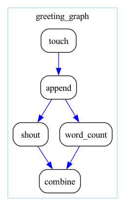
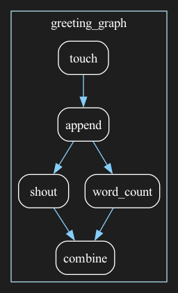
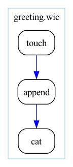

# Drawing a workflow

A picture of a workflow shows at a glance what a log hides: which step feeds
which, and which connections Sophios inferred rather than read from your
file. This page shows you how to draw a workflow and how to read the
drawing. Look at one before a long run: an inferred connection that went to
the wrong step is obvious in a picture.

You need Graphviz, which [Install](install.md) put in the conda environment.

## Draw a workflow in a notebook

If you explore in a Jupyter notebook, draw the workflow there.
`Workflow.draw()` compiles the workflow, as `compile()` does, and returns its
drawing as a `graphviz.Digraph`. Leave it as the last value of a cell:

```python
from greeting_graph import workflow

workflow().draw()
```

Jupyter asks the object for an image and shows it below the cell. Change a
step, run the cell again, and the picture follows:



To keep a drawing, render it to a file, or ask for the image's bytes:

```python
drawing = workflow().draw()
drawing.render('greeting_graph', format='png')
png_bytes = drawing.pipe(format='png')
```

`render()` writes two files, `greeting_graph`, the drawing's Graphviz
source, and `greeting_graph.png`, and returns the name of the image.
`pipe()` writes nothing and returns the PNG as bytes, for a script that
puts the image somewhere itself. The inline image, `render()` and `pipe()`
all run Graphviz's `dot` program, which [Install](install.md) put in your
environment; a notebook whose kernel lacks it raises `ExecutableNotFound`
instead of showing the drawing.

A Python drawing always carries its own opaque background, so it reads the
same in a light or a dark notebook, in an IDE and in an exported file. The
default is white, with black text, outlines and inferred edges and blue for
the connections you wrote. `draw(dark=True)` draws on a dark grey
background, `#1e1e1e`, with white text, outlines and inferred edges, and a
lighter blue, `lightskyblue`, for the connections you wrote:



`draw()` takes the same choices as the command-line flags below, as
`label_edges=`, `label_stepname=` and `inline_depth=`, and compiles with the
`inference=`, `tool_registry=` and `lang_version=` you would give
`compile()`, so it draws the edges `compile()` and `run()` would build.

## Draw a workflow from the command line

Add `--graphviz` to any command:

```bash
sophios --yaml greeting.wic --generate_cwl_workflow --graphviz
```

It writes three files into the base path:

| File | What |
|---|---|
| `greeting.wic.gv` | Sophios's drawing, as Graphviz source |
| `greeting.wic.gv.png` | the same, drawn by Graphviz's `dot` program |
| `greeting.svg` | cwltool's own drawing of the compiled CWL, for comparison |

Without `dot` on your `PATH`, Sophios prints a `wic029` note, compiles
without the drawing, and goes on. A command-line drawing has a transparent
background, so it sits on a slide or a page of any colour.

## Read the drawing

Here are `greeting.wic`, whose connections are all written, and
`greeting_inferred.wic`, the same three steps with every connection left to
[edge inference](edge-inference.md):




Each step is a box labelled with its id, and the workflow is a frame labelled
with its file name. A connection you wrote is blue; one Sophios inferred is
black, so you can tell what the file said from what the compiler decided.
The two graphs are the same, which is what inference is for. One arrow is
drawn for each pair of connected steps, however many ports connect them.

The drawing has a transparent background and boxes with no fill, so it
suits a light page or slide as it is. For a dark one, `--graph_dark_theme`
draws the text, the box outlines and the inferred edges in white, and the
connections you wrote in a lighter blue.

## Options

| Flag | Effect |
|---|---|
| `--graph_label_edges` | one edge per port, labelled with the name of the output it carries |
| `--graph_label_stepname` | label each box with its generated step name (`greeting__step__1__touch`) instead of its id or its `wic: graphviz: label` |
| `--graph_inline_depth N` | draw the steps of subworkflows nested up to depth `N`; a deeper call is one box |
| `--graph_dark_theme` | white text, box outlines and inferred edges, and explicit edges in a lighter blue, for a dark background |

## Labels and layout from the `.wic` file

The `wic:` block's `graphviz` key changes only the drawing:

```yaml
wic:
  graphviz:
    label: Make and print a file
    ranksame:
    - (1, touch)
    - (3, cat)
  steps:
    (1, touch):
      wic:
        graphviz:
          label: create the file
          style: dashed
steps:
- id: touch
  in:
    filename: !ii empty.txt
- id: append
  in:
    str: !ii Hello
- id: cat
```

- `label` on a step replaces its id as the label of its box; write `\n` for a
  line break. `--graph_label_stepname` overrides it with the generated name.
- `label` on a workflow, or on the `wic: steps:` entry that calls it, titles
  the workflow's cluster. A subworkflow without one is titled with the id it
  is called by.
- `style` on a step is appended to the box's own `rounded`; on a
  workflow it styles the cluster, and `invis` hides the cluster and the box of
  the step that calls it.
- `ranksame` lists steps of this document, as `(index, name)`, to draw on one
  rank. An entry that addresses no step is ignored, with a line on stderr.

`from_wic()` drops these keys with a warning, since a Python workflow has no
`wic:` block to hold them; `write_wic()` writes none.

## Recap

`Workflow.draw()` returns the drawing in Python, and shows it in a notebook;
`--graphviz` writes it beside the CWL on the command line. Either way there
is a box per step, blue arrows for the connections you wrote and black ones
for those Sophios inferred. The options change what is drawn, and a `.wic`
file's `wic: graphviz:` block changes labels and layout.
